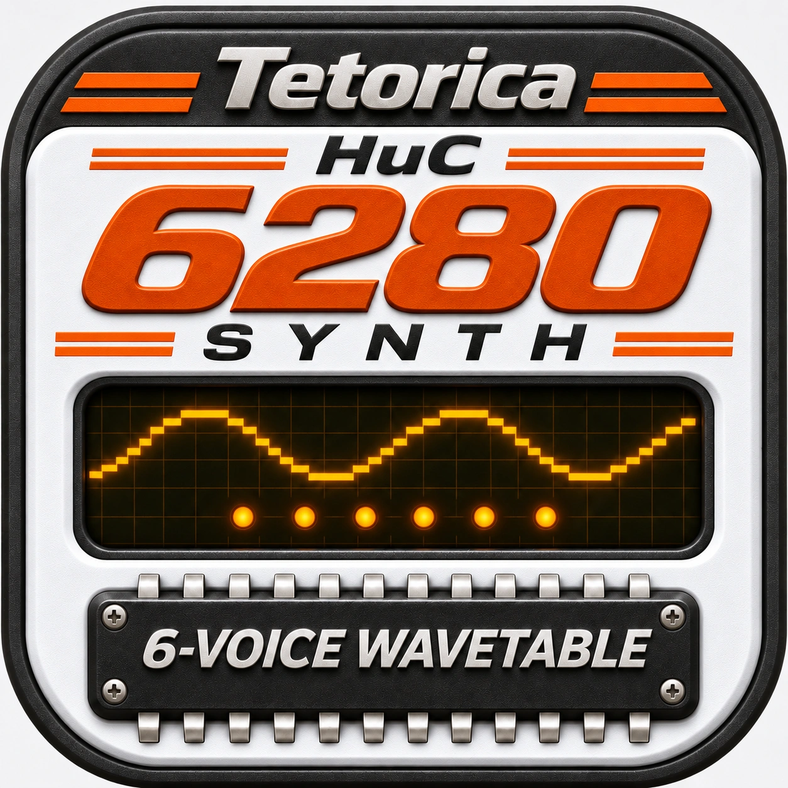

# Tetorica HuC6280 Synth — Desktop



Play the PC Engine's HuC6280 sound chip in a Tauri desktop app. This repository
wraps [Tetorica HuC6280 Synth](https://kyorohiro.github.io/hello_ymfm_wasm/synth-huc6280/index.html)
with the Menu, Pin and audio-output controls used by the other Tetorica Synths.

The current desktop version is **0.0.1**, using **Web Synth 0.0.8**. The Web
release is pinned by SHA-256 in [release.lock.json](release.lock.json).

## Sound and desktop controls

- Six-channel wavetable or five-bit DDA PCM, CH5 / CH6 Noise, paired CH1 / CH2
  hardware LFO, waveform drawing, software Envelope, Master, Pitch and Octave.
- WAV / audio loading, portable presets, VGM / VGZ sound extraction, and the
  optional **Wave / PCM: keep loudest volume variant** library view.
- **Menu** for file operations, audio output and reload; **Pin** keeps the
  window on top. Reload asks before discarding the current instrument.
- **Web Audio** is the default. **Native (Rust)** routes the final stereo Master
  bus to a CPAL output device. Changing output stops held notes and resets Pitch,
  while keeping the instrument and its samples.

The chip renderer remains the same WASM / AudioWorklet engine in both output
modes. Rust handles device output, Pin and native file saving. The waveform and
spectrum monitor remain attached to the final Master bus.

See the [included Synth guide](dist/README.md) for hardware controls, software
playback features, supported VGM forms and extraction limits.

## Run locally

Install Node.js, Python 3, Rust and the platform's
[Tauri prerequisites](https://v2.tauri.app/start/prerequisites/), then run:

```sh
npm ci
python3 scripts/import_release.py --check
npm test
cargo test --manifest-path src-tauri/Cargo.toml --locked
npm run dev
```

On Windows, use `python` if Python is not available as `python3`.

An unsigned macOS app can be built with:

```sh
npm run build -- --bundles app --no-sign -- --locked
```

The default local output is
`src-tauri/target/release/bundle/macos/Tetorica HuC6280 Synth.app`.
For separate signed Intel and Apple Silicon app / DMG builds, export
`APPLE_SIGNING_IDENTITY`, `APPLE_ID`, `APPLE_PASSWORD` and `APPLE_TEAM_ID`, then run
`sh deploy_mac.sh`. Keep their values outside this repository.

## Inspect and modify the code

The shipped JavaScript and CSS keep their module boundaries, comments and names.
There is no application bundling, minification or obfuscation step.

| Location | Purpose |
| --- | --- |
| [dist/synth-huc6280](dist/synth-huc6280/) | Readable Synth UI, instrument, VGM import and PCM code |
| [dist/js](dist/js/) | JavaScript chip API and runtime dependencies |
| [dist/generated](dist/generated/) | Original compiler-generated WASM loader and binary |
| [dist/sources](dist/sources/) | Matching C++ / SDK sources, build recipes and hash receipts |
| [desktop](desktop/) | Menu / Pin, native saving and final-bus audio adapters |
| [src-tauri/src](src-tauri/src/) | Tauri host and CPAL output |

Desktop adapters are injected by the local resource server; importing a release
does not rewrite its browser files. To edit files under `dist/`, make the edits,
record them and check the result:

```sh
npm run record:edits
python3 scripts/import_release.py --check
```

`local-changes.json` records your edits over the pinned release. The original
release hashes stay intact. Importing a new ZIP replaces `dist/`; keep your edits
in Git before updating and reapply them afterward.

## Import a Web release

Obtain a readable HuC6280 Synth ZIP from the parent project, then run:

```sh
npm run import:release -- /path/to/tetorica_huc6280_synth_VERSION_itch.zip
python3 scripts/import_release.py --check
```

The importer validates archive paths, product identity, readable-module receipts,
the WASM / native-source receipts and required licenses before replacing `dist/`.
Both `dist/` and `release.lock.json` belong in Git. `.gitattributes` preserves the
imported bytes across platforms, including Windows checkouts.

## Verification and CI

```sh
npm test
npm run test:browser -- --out artifacts/desktop-browser.json --screenshots artifacts/screenshots
cargo test --manifest-path src-tauri/Cargo.toml --locked
```

The browser check exercises real HuC6280 WASM and AudioWorklets in Chromium and
WebKit with a mocked desktop IPC host and muted speakers. It verifies the UI and
audio transport; it does not replace listening through a physical output device.
The default Rust tests also avoid opening an audio device.

[Build Desktop](.github/workflows/build-desktop.yml) configures macOS Apple
Silicon / Intel, Windows x64 and Linux x64 / ARM64 builds. Main-branch builds
produce workflow artifacts. Tags starting with `v` attach installers to a
**draft** GitHub release. CI builds are unsigned; local `deploy_mac.sh` uses the
credentials you export. Actual hosted CI results require pushing this repository.

Current work and remaining manual checks are recorded in
[the TODO](docs/todo_20261106.md) and [verification notes](docs/verification_20261106.md).

## Sources and licenses

The desktop wrapper uses the [BSD 3-Clause license](LICENSE). The imported Synth,
HuC6280 implementation and dependencies retain their own notices under
[dist/licenses](dist/licenses/) and [dist/sources](dist/sources/).

- [Tetorica project and reusable sound-chip APIs](https://github.com/kyorohiro/hello_ymfm_wasm)
- [HuC6280 Synth source](https://github.com/kyorohiro/hello_ymfm_wasm/tree/main/docs/synth-huc6280)
- [Tetorica native sound-chip library](https://github.com/kyorohiro/tetorica-soundchip-native)
- [Tauri](https://tauri.app/)

## 日本語

PC EngineのHuC6280を試奏するTauri版です。Web版0.0.8の可読ソースをそのまま
含み、Menu・Pin・音声出力設定を追加しています。初期状態はWeb Audioで、Native
出力でも音源処理は同じWASM／AudioWorkletを使い、最後のステレオ出力をRustから
デバイスへ送ります。VGM、WAV、プリセット読み込みと保存に対応します。

実デバイスでの実聴・長時間動作と、各OS上の最終確認はTODOを参照してください。
